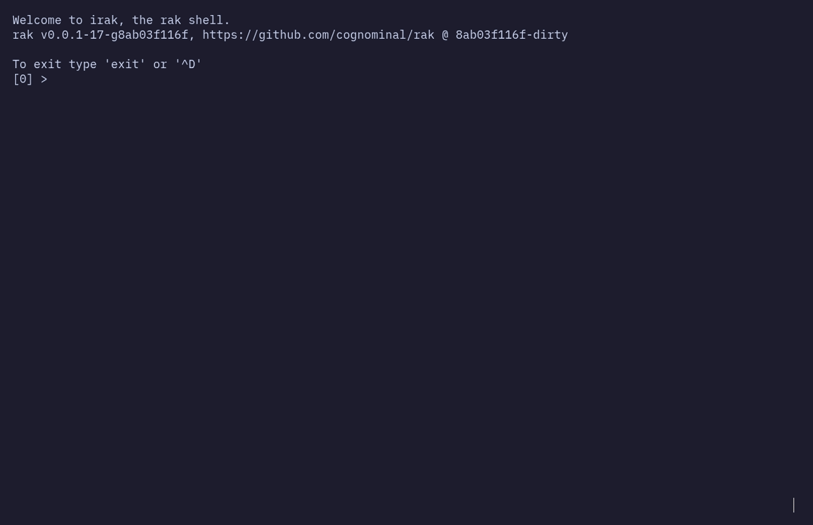
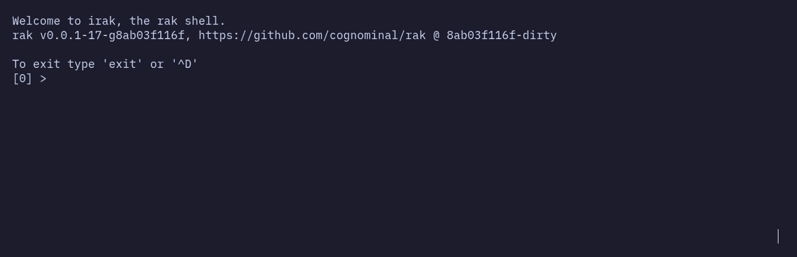

# Rak

This is ongoing work on rak, a dialect of rakudo that
supports shell syntax with [naked strings](rak-docs/CHEATSHEET.md#naked-string) and `irak` a mode for interactive sessions.
rak [dwims](GLOSSARY.md#dwim), [huffs](GLOSSARY.md#huff) and
[topics](GLOSSARY.md#topic) to the max, which makes it practical the way natural
language is, true to Larry Wall's
[natural language principles](https://gist.github.com/uzluisf/9ef7a3ede109b32e15085a6beccfa7c4).
Like Perl, rak finds "no shame in borrowing" from the shell, but
[leaves behind more than it takes](https://www.perl.com/pub/1999/03/pm.html).
See [CHEATSHEET](rak-docs/CHEATSHEET.md) for a quick presentation intended for raku connoisseurs.
See [Glossary](./GLOSSARY.md) for new concepts.
See [ROADMAP](rak-plans/ROADMAP.md) for the planned versions.
[adrs](./docs/adr) are Architectural decision records.
From now on, I will try to stick to Matt Pocock [skills](https://github.com/mattpocock/skills).

Reader docs are in [rak-docs/](rak-docs/README.md); design docs are in
[rak-plans/](rak-plans/README.md).

A tour of irak ([how these are made](rak-docs/demos/README.md)):

Pipes and the web:

## Build and test

Building and installing are as for Rakudo: see [README-raku.md](README-raku.md).
Once it is built, the `./rak` wrapper at the repo root runs the rak frontend.
`make rak-test` runs the rak-specific tests (`t/*/rak/`), which `make test`
and `make spectest` don't run.
