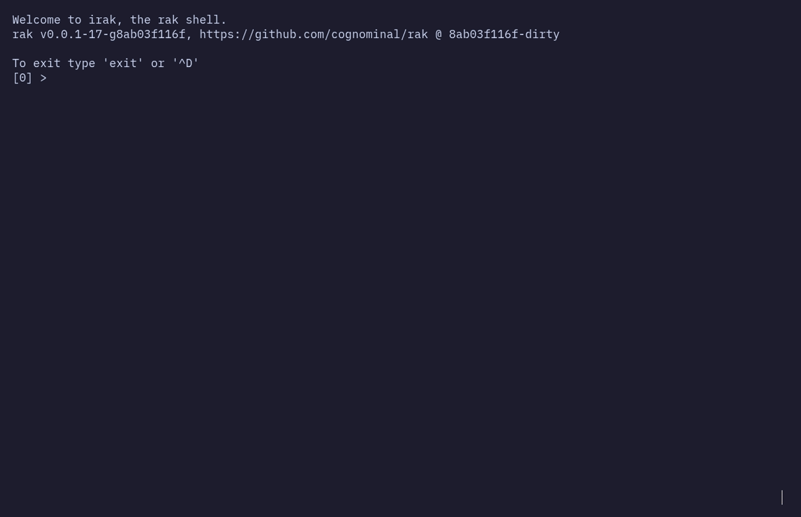
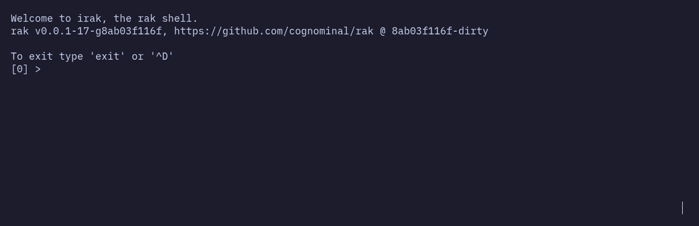

# Demo recordings

Terminal recordings of irak, as GIFs. Each `NAME.tape` is a
[vhs](https://github.com/charmbracelet/vhs) script that types into irak; `vhs`
replays it in a headless terminal and writes `NAME.gif` beside it. The GIFs are
committed, so they show on GitHub without a build.



- [showcase.tape](showcase.tape): a tour of irak: naked strings, the `my` irak
  adds, dotty subscripts, `->` on the topic, a load, TAB completion through fzf,
  value-mode redirection, an external command and pinning the topic.
- [web.tape](web.tape): a pipe from rak stages into a command, a GitHub URL load,
  and the request and response headers in irak's web log, `@*IWEB`. It needs the
  network, and its star count and rate limit change from one rebuild to the next.



These are recordings. A written demonstration such as
[GitHub as a rak demonstration](../../rak-plans/demos/github.md) lives in
`rak-plans/demos/`.

## Rebuilding

```bash
make rak-demos                    # every *.tape, after a build
vhs rak-docs/demos/showcase.tape  # one, from the repo root
```

Both need `vhs` (it pulls in `ttyd` and `ffmpeg`) and `fzf`. Commit with a clean
tree first if you want it: the banner shows HEAD, with `-dirty` otherwise.

## Writing a tape

- Start irak through [run-demo](run-demo), hidden, then `Show` once the `[0] >`
  prompt is up. `run-demo` gives irak empty XDG folders (no `init.rak`, aliases
  or history of yours), turns off atuin recording (`RAKUDO_DISABLE_ATUIN`), and
  runs in a scratch folder holding a copy of [fixtures/](fixtures/).
- Type the code at `TypingSpeed` (50 ms), then its comment at `Type@15ms`, padded
  so every `#` starts at column 41, or two spaces after longer code.
- Run a line with `Enter`, `Sleep 600ms`, `Enter`: the first ENTER shows how
  irak reads the line, and the second must come within a second to run it.
- Use local data where you can, so a rebuild gives the same GIF.
- Name translations `NAME.fr.tape`, `NAME.ru.tape`.
