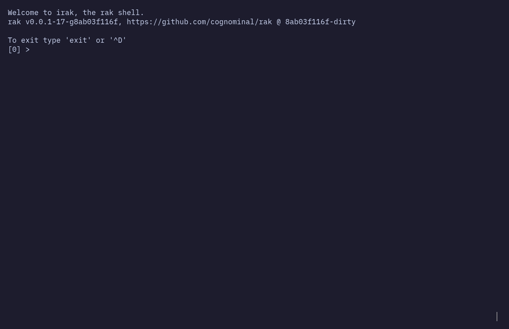

# rak 0.0.2

A second preview of [0.1](../../rak-plans/ROADMAP.md), mostly for irak, the interactive shell.
Expect rough edges: backward compatibility is not kept before 0.5. See
[0.0.1](0.0.1.md) for what rak is and what the first preview held, and the
[cheat sheet](../CHEATSHEET.md) for the syntax.



## What's new

irak:

- **TAB completes** a selector (`%d.de`, `$x.1.na`) or a `->` method through
  [fzf](https://github.com/junegunn/fzf), previewing each value. The subject is found
  by reading the dotty chain, never by running code. fzf is now a required dependency.
- **Pinning the topic**: a lone `-` pins `$_`, and the prompt ends in `-`
  (`[3] >- `). While it is pinned, submissions show their values but leave `$_`
  alone, except a `! ` submission or `!!n`. Another `-` unpins it. A comment may
  follow the `-`.
- **atuin**: when [atuin](https://atuin.sh) is installed, irak records each submission
  in its history, and Ctrl-R searches it. `RAKUDO_DISABLE_ATUIN` turns both off.
- **A startup file**, `$XDG_CONFIG_HOME/rak/init.rak`, runs before the first
  submission. irak's history moves to `$XDG_STATE_HOME/rak/history`; the old
  `~/.raku/irak-history` is not migrated.
- A bar cursor while a line is edited.

The language:

- **Aliases**: `alias ll=ls -l`, then `ll /tmp`. An alias is lexical, so one in
  `init.rak` lasts the irak session.
- **Stacked redirections**: a load can be written out in the same statement,
  `my %d <data.json >copy.json`.
- A command that is found neither as a path nor on `$PATH` now dies with
  `name: command not found`.

Documentation:

- the cheat sheet opens with what irak is, and lists irak's keys;
- [demo GIFs](../demos/README.md) of irak, rendered by vhs from scripts with
  `make rak-demos`.

Known gaps are listed in [status.md](../../rak-plans/status.md).

## Built on

Unchanged since 0.0.1:

- Rakudo main 8e36510f59 (2026.11 plus later commits), RakuAST frontend;
- NQP 2026.11-12-g5fbb82e9a and MoarVM 2026.11-21-gfbae51aca;
- Terminal::LineEditor 0.0.23, patched for irak's line editing. The patch now also
  stops its input parser from taking the next reader's first key, which atuin needs.

## Installing

`rak-0.0.2.tar.gz`, attached to the release, holds everything the build needs, with
no network access. On Arch, from a rak checkout:

```sh
cd packaging/aur/rak && makepkg -si
```

Elsewhere, see [Building from the tarball](../../rak-plans/build/release.md#building-from-the-tarball).
Run `rak` for irak, or `rak file.rak`. irak needs fzf for TAB; atuin is optional.
